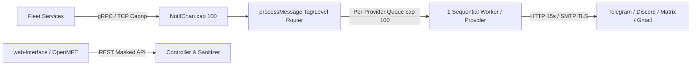

# 🏗️ Architecture Overview

The `notif-server` follows a **Centralized Aggregator / Isolated Sequential Dispatch** pattern.

## Key Design Pillars

1. **Multi-Protocol Ingestion & Control**:
   * **TCP (Cap'n Proto)**: High-performance binary streaming with `safe-socket` (`10m` idle timeout).
   * **gRPC (Protobuf)**: Dual service hosting `NotifService` (ingestion) and `NotifControlService` (management).
   * **HTTP REST & OpenMFE**: Management endpoints (`/api/v1/*`), self-describing `/api/v1/contracts`, and embedded `<notif-server-mfe>` web component.
2. **Isolated Sequential Provider Workers**:
   * Each configured provider instance (including multiple instances of the same platform type, keyed by canonical tag) owns **1 dedicated sequential worker goroutine** and **1 buffered queue (capacity 100)**.
   * Preserves strict message ordering, avoids external API rate-limit bursts, and isolates slow providers (e.g., SMTP/Gmail) from fast providers (e.g., Telegram).
3. **Immutable Senders & Zero-Loss Live Hot-Reload**:
   * Credentials (`ENC(...)` or plaintext) are decrypted **once at instantiation** in `New...Sender()` (failing fast on corrupt ciphertext). Senders are immutable and lock-free on the hot dispatch path.
   * `Notifier.Reload(newConf)` diffs deep-copied configs, closes replaced queues so old workers finish draining (`<-prevDone`), and mounts fresh senders on the fly with zero dropped in-flight alerts.
   * `Notifier.Stop()` is idempotent (`sync.Once`), rejects new `Notify()`/`Reload()`/`RegisterSender()` calls, drains `NotifChan` (`processWg`), closes all provider queues, and awaits worker termination (`workersWg`).
4. **Resilient Delivery & Security**:
   * **Exponential Backoff**: 3 delivery attempts (500ms → 1s → 2s) using reusable per-sender `15s` timeout-guarded `*http.Client` instances and 30s worker context deadlines.
   * **Universal Fallback**: Auxiliary provider failures route a fallback alert to `DefaultSender` (Telegram); Telegram itself is terminal (loop-breaker).
   * **Centralized Sanitization (`src/sanitizer`)**: Deny-by-default config masking for `web-interface`, MIME header/filename sanitization, kernel-confined Gmail attachments (`os.OpenRoot`, 10 MB cap), and exhaustive secret redaction in logs and status errors.
5. **Real-Time Telemetry**:
   * Live provider states (`Initialized`, `Operational`, `Degraded`, `Unavailable`, `Stopped`), queue depths, delivered/failed/dropped counters, and redacted `last_error` surfaced via `/api/v1/status` and gRPC `GetStatus`.

## Data Flow Diagram

